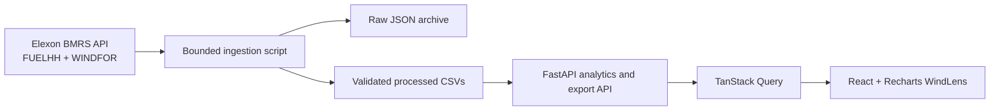

# Architecture

WindLens is a modular monolith with a separate data-ingestion pipeline. The dashboard does not fetch the full Elexon history every time someone opens a page. The ingestion script retrieves and validates the source data, keeps raw JSON for auditing, and writes processed CSVs. Data selection and metric calculations are separate from the FastAPI routes.

The API loads processed CSVs into a small in-process cache keyed by file modification time. Re-ingestion invalidates the cache. Changing the forecast cutoff recalculates selection from the cached versions. On hosts with ephemeral storage, set `DATA_DIR` to durable storage if files need to survive a fresh deployment.

FUELHH requests use settlement dates and the WIND fuel type. WINDFOR requests use publication-time windows no longer than seven days, and the returned raw records are retained. The analysis creates each expected half-hour UTC interval, calculates a cutoff in Europe/London for each delivery date, and selects the latest forecast published on or before that cutoff. It joins the selected forecast to actual generation by normalized UTC `startTime`.

The default 10:00 day-ahead cutoff is an assumption. When conflicting rows share an interval and publication time, a stable sorted-JSON rule selects one; quality counts preserve evidence of the conflict. Metric functions return null when there are no samples or WAPE's denominator is zero.
