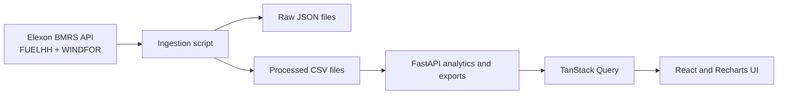

# Architecture

WindLens keeps the web app and data-processing code in one repository. It does not download the full Elexon history whenever someone opens the dashboard. A controlled ingestion script fetches and validates data, saves the original rows, and builds the CSV files used by the API.

## Data flow

The script requests FUELHH records filtered to wind and WINDFOR forecast versions. FUELHH requests use settlement dates; WINDFOR requests use publication-time windows of up to seven days. The ingestion report records the request windows, counts, retrieval time, and warnings.

The backend reads the processed CSVs. It caches them in memory using each file's modification time, so a changed file is read again. When a request uses a different cutoff, the backend selects forecast versions again from the cached data.

The frontend is a React app. TanStack Query fetches data from the FastAPI service, and Recharts displays the time series and accuracy results. Docker Compose runs the frontend and backend together for local development.

## Forecast and actual matching

WINDFOR delivery starts in the committed data are hourly. FUELHH actuals have half-hour starts. WindLens creates the expected hourly starts, calculates the cutoff at the configured time on the preceding day in `Europe/London`, and selects the latest version with `publishTime` at or before that cutoff. Timestamps are compared as timezone-aware UTC instants, and records are joined by delivery `startTime`.

For each hour, actual generation is the mean MW of the two FUELHH readings that start in that hour. If either reading is missing, that hourly actual stays unavailable. WindLens does not copy an hourly forecast into half-hour periods or interpolate missing data.

The default cutoff is 10:00 Europe/London. It is an analytical setting, not a confirmed procurement deadline. If conflicting rows share a delivery start and publication time, ingestion applies a stable rule and records the conflict in the quality report. Metrics are unavailable when there are no valid matched pairs; WAPE is also unavailable when total actual generation is zero.

## Coverage and cache

The January analysis has 744 expected hourly forecast starts and 1,488 expected half-hour actual intervals. Forecast availability and matched coverage use the hourly denominator. Actual coverage uses the half-hour denominator. The committed cache has 744 eligible forecasts and matched pairs at the default cutoff.

The forecast publication search starts 14 days before January. It covers the publication times observed in the cache, but this does not establish that the archive has no older versions. See [known limitations](known-limitations.md) for the current retrieval boundary and deployment status.

The Docker image includes the data files. On a host with temporary storage, file changes made at runtime may not survive a redeploy. Configure persistent storage if runtime ingestion needs to persist between deployments.
