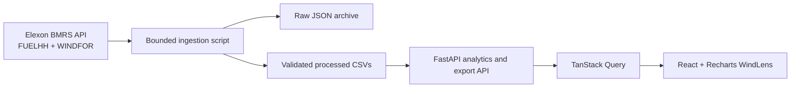

# Architecture

The project is a modular monolith. Ingestion is a reproducible offline pipeline, so normal dashboard requests never download the full upstream history. Data selection and metric functions are separate from FastAPI routes. Processed CSVs are loaded through a bounded in-process cache keyed by file modification time; re-ingestion invalidates that cache, and changing cutoff recomputes selection from the cached versions. Set `DATA_DIR` to durable storage for ephemeral hosts.

FUELHH records are requested by settlement date and WIND fuel type. WINDFOR records are requested by publication-time partitions no longer than seven days; raw records are retained. The analysis creates every expected 30-minute UTC slot, calculates each delivery date's cutoff in Europe/London, then selects the latest publication no later than that cutoff. The chosen forecast joins actual generation by normalized UTC `startTime`.

The default 10:00 cutoff is explicitly an assumption. A stable lexical JSON tie break resolves conflicting same-time duplicates and quality counts retain evidence of those conflicts. Metric functions return null for empty samples and zero-denominator WAPE.

